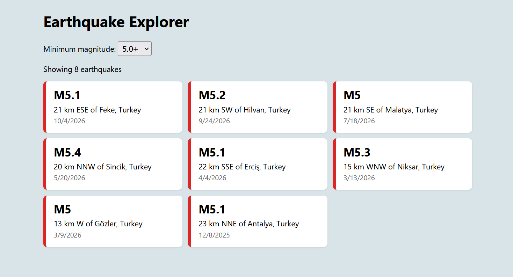

# Earthquake Explorer

React app that fetches recent earthquakes from the USGS API and lets you filter them by magnitude.

##Live site 
https://earthquake-explorer-lemon.vercel.app/


## Features

- Fetches the latest 100 earthquakes (M3+) in a bounding box around Turkey
- Filter by minimum magnitude
- Color-coded cards (red: M5+, orange: M4-5, blue: below M4)
- Loading and error states

## Tech

React, Vite, USGS Earthquake API

## Run locally

```bash
git clone https://github.com/yesilkirpi/earthquake-explorer.git
cd earthquake-explorer
npm install
npm run dev
```

## Notes

The query uses a bounding box, so results can include earthquakes near Turkey (e.g. Greece, Syria, Georgia).

Related project: [turkey-earthquake-analysis](https://github.com/yesilkirpi/turkey-earthquake-analysis) (Python data analysis of the same data source).
